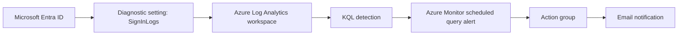

# Microsoft Entra Privileged Sign-In Monitoring & Alerts

Hands-on Azure identity-security lab demonstrating how to export Microsoft Entra sign-in events to Azure Monitor Logs, investigate them with Kusto Query Language (KQL), and configure email notifications for privileged account activity.

> **Lab status (October 23, 2026):** Log Analytics workspace creation and Entra `SigninLogs` ingestion have been verified. A scheduled query alert was configured in the Azure portal, but an earlier create attempt returned `Microsoft.Insights/scheduledQueryRules/write` authorization failure. **Successful alert creation and email delivery have not yet been verified.**

## Objectives

- Centralize Microsoft Entra interactive sign-in telemetry in a Log Analytics workspace.
- Identify successful and failed sign-ins for monitored emergency access accounts.
- Build a log search alert with an Azure Monitor email action group.
- Verify the detection path end-to-end without exposing live tenant identifiers.
- Understand the limits of fixed account lists versus dynamic Global Administrator membership.

## Architecture



The diagram is the intended monitoring design. Only the Entra-to-Log-Analytics data flow has been directly validated so far.

## Technologies

Microsoft Entra ID · Azure Monitor · Log Analytics · KQL · Azure RBAC · Azure Monitor Action Groups · Privileged Identity Management (PIM)

## Implementation

1. **Provision a Log Analytics workspace** within an Azure subscription and resource group.
2. In **Entra admin center → Entra ID → Monitoring & health → Diagnostic settings**, select `SignInLogs` and `AuditLogs`, sending them to the workspace.
3. Confirm that new records arrive in the `SigninLogs` table using `queries/01-ingestion-health.kql`.
4. Use `queries/02-privileged-signins.kql` as a **template**, replacing placeholders with actual Entra user **Object IDs** in your private environment.
5. Create an Azure Monitor **Custom log search** alert for matching sign-ins.
6. Attach an email action group, configure severity and alert behavior, and test the notification.
7. Review rule health, permissions, coverage, cost, and the results of an authorized test sign-in.

## Detection scope and limitations

**Emergency account monitoring:** Explicit Object IDs provide stable detection even if a monitored account's UPN changes. The repository intentionally contains placeholders, not live Object IDs.

**All Global Administrators:** `SigninLogs` alone does **not** reliably establish who held the Global Administrator role at the moment of authentication. To cover every current and future Global Administrator, maintain a role-assignment inventory, account for PIM activation/deactivation and historical changes, and correlate it with sign-in events. A fixed list should never be presented as dynamic role detection.

**Sign-in types:** `SigninLogs` addresses interactive sign-ins. Non-interactive account activity requires appropriate diagnostic categories and separate detection logic.

**Alert delivery:** Log ingestion, evaluation intervals, stateful/stateless behavior, and notification processing introduce latency. A matching sign-in is not guaranteed to yield exactly one email.

## Repository structure

```text
.
├── README.md
├── docs/
│   ├── architecture.md
│   └── validation-checklist.md
├── queries/
│   ├── 01-ingestion-health.kql
│   ├── 02-privileged-signins.kql
│   └── 03-failed-privileged-signins.kql
└── screenshots/
    └── README.md
```

## Evidence

Add **redacted** PNG screenshots to `screenshots/`. Suggested captures are the Entra diagnostic-setting configuration, Log Analytics sign-in results, and Azure Monitor alert review screen. Screenshot filenames and captions are documented in `screenshots/README.md`.

## Security considerations

- Never commit credentials, tokens, unredacted UPNs, IP addresses, Object IDs, tenant IDs, or subscription IDs.
- Keep emergency access accounts excluded from policies that could prevent emergency recovery; protect them with phishing-resistant credentials and monitor their use.
- Use least-privilege Azure RBAC for provisioning and monitoring. Remove temporary elevated access after use.
- Store notifications in an inbox independent of the monitored tenant, where appropriate.
- Validate action group delivery and scheduled query permissions before calling the alert operational.

## Costs

Azure Monitor log-search alert rules and Log Analytics ingestion may be billable. The Azure portal showed **$1.50** as the estimated price for the configured alert at the time of review; this is not a guarantee of total Azure spend. Confirm pricing in the subscription's billing region and monitor Cost Management.

## Related work

This lab complements Azure RBAC/PIM activation monitoring and Entra PIM role-activation labs; it detects **sign-in activity**, which is a different security signal from role activation.

## References

- [Microsoft Entra diagnostic settings](https://learn.microsoft.com/en-us/entra/identity/monitoring-health/howto-configure-diagnostic-settings)
- [Azure Monitor log search alerts](https://learn.microsoft.com/en-us/azure/azure-monitor/alerts/alerts-create-log-alert-rule)
- [Manage emergency access accounts in Microsoft Entra ID](https://learn.microsoft.com/en-us/entra/identity/role-based-access-control/security-emergency-access)
- [Kusto Query Language](https://learn.microsoft.com/en-us/kusto/query/)
