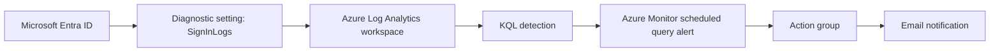
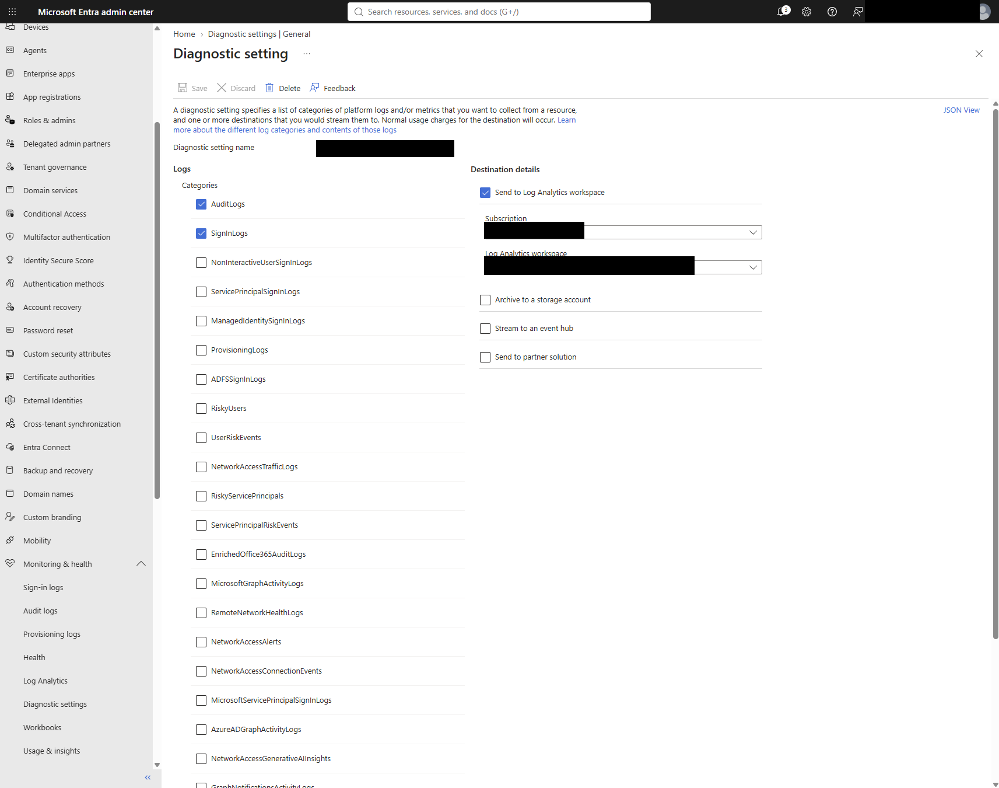
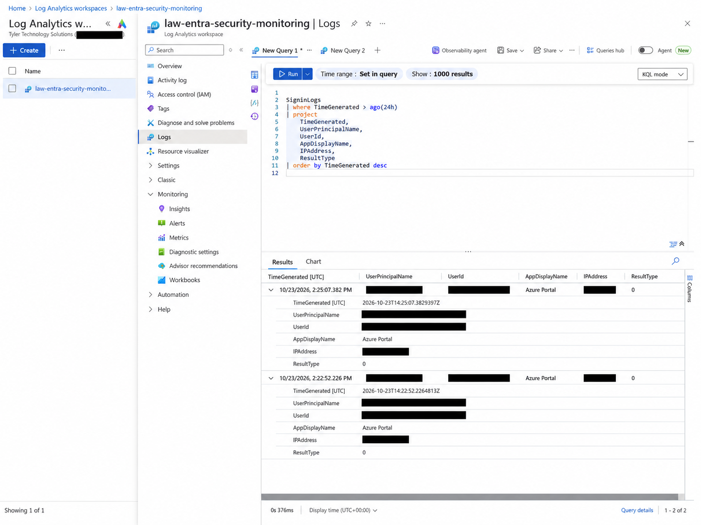
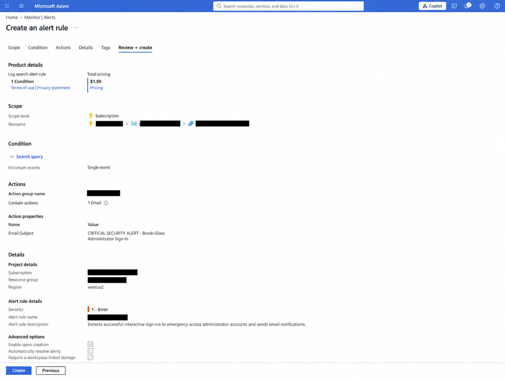
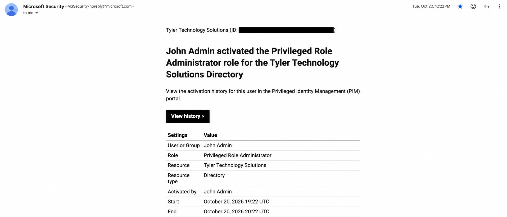

# Microsoft Entra Privileged Sign-In Monitoring & Alerts

Hands-on Azure identity-security lab demonstrating how to export Microsoft Entra sign-in events to Azure Monitor Logs, investigate them with Kusto Query Language (KQL), and document privileged account monitoring. The lab also validates Microsoft Entra PIM's automatic email notification for a directory-role activation; this is a separate mechanism from Azure Monitor log-search alerts.

## Objectives

- Centralize Microsoft Entra interactive sign-in telemetry in a Log Analytics workspace.
- Identify successful and failed sign-ins for monitored emergency access accounts.
- Build a log search alert with an Azure Monitor email action group.
- Validate native PIM role-activation email notifications with a controlled test activation.
- Verify the Azure Monitor detection and email-delivery path independently without exposing live tenant identifiers.
- Understand the limits of fixed account lists versus dynamic Global Administrator membership.

## Architecture



The diagram is the **Azure Monitor sign-in detection design**. Entra-to-Log-Analytics ingestion has been validated, while end-to-end scheduled-query alert firing and action-group email delivery remain unverified. **Native Entra PIM role-activation email notifications are a separate, validated notification path**, not evidence that the Azure Monitor design has fired.

## Technologies

Microsoft Entra ID · Azure Monitor · Log Analytics · KQL · Azure RBAC · Azure Monitor Action Groups · Privileged Identity Management (PIM)

## Implementation

1. **Provision a Log Analytics workspace** within an Azure subscription and resource group.
2. In **Entra admin center → Entra ID → Monitoring & health → Diagnostic settings**, select `SignInLogs` and `AuditLogs`, sending them to the workspace.
3. Confirm that new records arrive in the `SigninLogs` table using `queries/01-ingestion-health.kql`.
4. Use `queries/02-privileged-signins.kql` as a **template**, replacing placeholders with actual Entra user **Object IDs** in your private environment.
5. Create an Azure Monitor **Custom log search** alert for matching sign-ins.
6. Attach an email action group, configure severity and alert behavior, and test the notification.
7. Review rule health, permissions, coverage, cost, and the results of an authorized test sign-in.

## Validated PIM activation email notification

A controlled Microsoft Entra Privileged Identity Management (PIM) activation generated an automatic Microsoft Security notification email. The message identifies the activating account, the **Privileged Role Administrator** directory role, the directory, and the **October 20, 2026, 19:22–20:22 UTC** activation window (one hour). This validates receipt of a native PIM role-activation email notification in the lab.

This event is a **directory-role activation**, not an interactive sign-in alert. It does **not** establish that Azure Monitor's KQL scheduled-query alert or its action group sent an email. These two monitoring paths must be tested and reported independently.

## Detection scope and limitations

**Emergency account monitoring:** Explicit Object IDs provide stable detection even if a monitored account's UPN changes. The repository intentionally contains placeholders, not live Object IDs.

**All Global Administrators:** `SigninLogs` alone does **not** reliably establish who held the Global Administrator role at the moment of authentication. To cover every current and future Global Administrator, maintain a role-assignment inventory, account for PIM activation/deactivation and historical changes, and correlate it with sign-in events. A fixed list should never be presented as dynamic role detection.

**Sign-in types:** `SigninLogs` addresses interactive sign-ins. Non-interactive account activity requires appropriate diagnostic categories and separate detection logic.

**Alert delivery:** Log ingestion, evaluation intervals, stateful/stateless behavior, and notification processing introduce latency. A matching sign-in is not guaranteed to yield exactly one email.

## Repository structure

```text
.
├── README.md
├── docs/
│   ├── architecture.md
│   └── validation-checklist.md
├── queries/
│   ├── 01-ingestion-health.kql
│   ├── 02-privileged-signins.kql
│   └── 03-failed-privileged-signins.kql
└── screenshots/
    ├── 01-alert-rule-review-redacted.png
    ├── 02-signin-log-query-results-redacted.png
    ├── 03-entra-diagnostic-settings-redacted.png
    └── 04-pim-role-activation-email-alert-redacted.png  (upload pending)
```

## Evidence

The following redacted screenshots are stored in the repository and displayed in implementation order. Identifiers have been obscured for public documentation.

### 1. Microsoft Entra diagnostic settings

The Entra tenant's diagnostic setting routes `SignInLogs` and `AuditLogs` to Log Analytics.



### 2. KQL sign-in log verification

The `SigninLogs` query returned successful interactive sign-in records, verifying that data reached the workspace.



### 3. Azure Monitor alert rule configuration

The alert wizard review shows the configured single-event log search, selected email action group, and severity. **This screenshot documents configuration only, not successful deployment or email delivery.** The initial creation attempt encountered an RBAC write authorization error, and successful alert firing remains unverified.



### 4. Native PIM role-activation email — validated

On October 20, 2026, Microsoft Security sent an automatic notification when the lab administrator activated the **Privileged Role Administrator** directory role. The email shows the activating identity, role, directory, and one-hour activation window. This provides evidence of successful **native PIM notification delivery**.

**Screenshot upload pending:** Save the redacted PNG as `screenshots/04-pim-role-activation-email-alert-redacted.png`. Once uploaded, the image below will render automatically.



**Validation boundary:** This confirms a native Microsoft Entra PIM activation email, **not** successful Azure Monitor scheduled-query alert delivery. The Azure Monitor alert configuration above remains unverified end-to-end.

See [validation checklist](docs/validation-checklist.md) for outstanding end-to-end tests.

## Security considerations

- Never commit credentials, tokens, unredacted UPNs, IP addresses, Object IDs, tenant IDs, or subscription IDs.
- Keep emergency access accounts excluded from policies that could prevent emergency recovery; protect them with phishing-resistant credentials and monitor their use.
- Use least-privilege Azure RBAC for provisioning and monitoring. Remove temporary elevated access after use.
- Store notifications in an inbox independent of the monitored tenant, where appropriate.
- Validate action group delivery and scheduled query permissions before calling the alert operational.

## Costs

Azure Monitor log-search alert rules and Log Analytics ingestion may be billable. The Azure portal showed **$1.50** as the estimated price for the configured alert at the time of review; this is not a guarantee of total Azure spend. Confirm pricing in the subscription's billing region and monitor Cost Management.

## Related work

This repository covers **two distinct signals**: Entra **sign-in activity** exported to Log Analytics for KQL-based analysis, and **directory-role activation** notifications sent by native PIM. The PIM email path is validated; the Azure Monitor log-search alert delivery path is not yet verified end-to-end.

## References

- [Microsoft Entra diagnostic settings](https://learn.microsoft.com/en-us/entra/identity/monitoring-health/howto-configure-diagnostic-settings)
- [Azure Monitor log search alerts](https://learn.microsoft.com/en-us/azure/azure-monitor/alerts/alerts-create-log-alert-rule)
- [Manage emergency access accounts in Microsoft Entra ID](https://learn.microsoft.com/en-us/entra/identity/role-based-access-control/security-emergency-access)
- [Kusto Query Language](https://learn.microsoft.com/en-us/kusto/query/)
